<!-- Akshat Gupta · github.com/Akshat-Gupta04 · assets in /assets are generated SVGs (light + dark) -->

  <a href="https://akshat-gupta.tech"><picture><source media="(prefers-color-scheme: dark)" srcset="assets/header-dark.svg"><source media="(prefers-color-scheme: light)" srcset="assets/header-light.svg"></picture></a>

  <a href="https://akshat-gupta.tech"><picture><source media="(prefers-color-scheme: dark)" srcset="assets/btn-portfolio-dark.svg"></picture></a>
  <a href="https://umzobo.studio"><picture><source media="(prefers-color-scheme: dark)" srcset="assets/btn-umzobo-dark.svg"></picture></a>
  <a href="https://www.linkedin.com/in/akshat-gupta-077a7b256/"><picture><source media="(prefers-color-scheme: dark)" srcset="assets/btn-linkedin-dark.svg"></picture></a>
  <a href="mailto:akshat9306@gmail.com"><picture><source media="(prefers-color-scheme: dark)" srcset="assets/btn-email-dark.svg">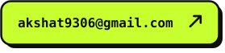</picture></a>

  <picture><source media="(prefers-color-scheme: dark)" srcset="assets/whoami-dark.svg"><source media="(prefers-color-scheme: light)" srcset="assets/whoami-light.svg"></picture>

 

<picture><source media="(prefers-color-scheme: dark)" srcset="assets/div-01-dark.svg"><source media="(prefers-color-scheme: light)" srcset="assets/div-01-light.svg"></picture>

  <a href="https://umzobo.studio"><picture><source media="(prefers-color-scheme: dark)" srcset="assets/card-umzobo-dark.svg"><source media="(prefers-color-scheme: light)" srcset="assets/card-umzobo-light.svg">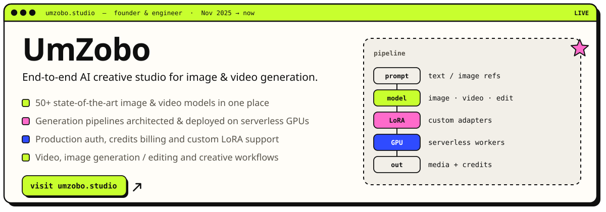</picture></a>

  <picture><source media="(prefers-color-scheme: dark)" srcset="assets/card-fleet-dark.svg"><source media="(prefers-color-scheme: light)" srcset="assets/card-fleet-light.svg">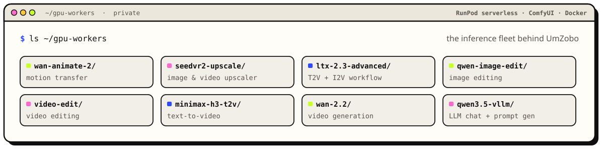</picture>

The workers above live in private repos, so they are listed here without links.

 

<picture><source media="(prefers-color-scheme: dark)" srcset="assets/div-02-dark.svg"><source media="(prefers-color-scheme: light)" srcset="assets/div-02-light.svg">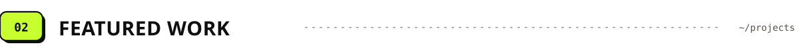</picture>

  <a href="https://github.com/Akshat-Gupta04/H3-Minimax-Runpod-Serverless"><picture><source media="(prefers-color-scheme: dark)" srcset="assets/card-h3-minimax-dark.svg"><source media="(prefers-color-scheme: light)" srcset="assets/card-h3-minimax-light.svg">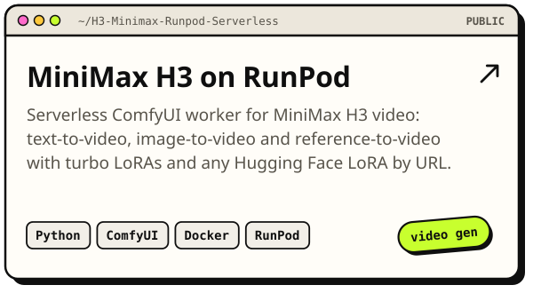</picture></a>
  <a href="https://github.com/Akshat-Gupta04/ComfyUI-MiniMax-H3-R2VA"><picture><source media="(prefers-color-scheme: dark)" srcset="assets/card-r2va-nodes-dark.svg"><source media="(prefers-color-scheme: light)" srcset="assets/card-r2va-nodes-light.svg">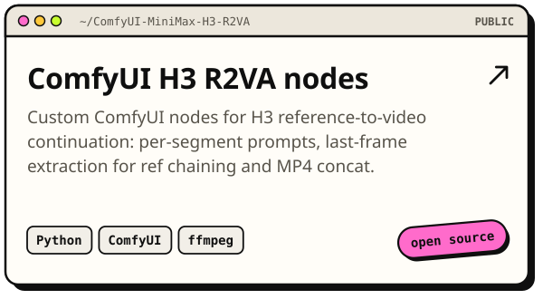</picture></a>

  <a href="https://github.com/Akshat-Gupta04/LTX-serverless-RunPod"><picture><source media="(prefers-color-scheme: dark)" srcset="assets/card-ltx23-dark.svg"><source media="(prefers-color-scheme: light)" srcset="assets/card-ltx23-light.svg">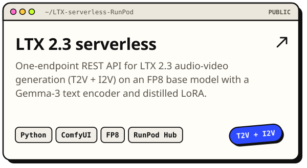</picture></a>
  <a href="https://github.com/Akshat-Gupta04/CodeMind-AI-Powered-Code-Knowledge-Retrieval-System"><picture><source media="(prefers-color-scheme: dark)" srcset="assets/card-codemind-dark.svg"><source media="(prefers-color-scheme: light)" srcset="assets/card-codemind-light.svg">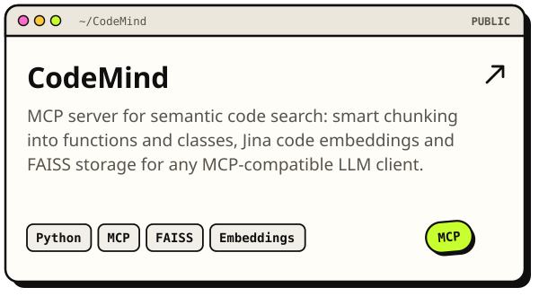</picture></a>

  <a href="https://github.com/Akshat-Gupta04/Story-Generation-with-Constraint-Words--Knowledge-Distillation-of-GPT-2"><picture><source media="(prefers-color-scheme: dark)" srcset="assets/card-story-kd-dark.svg"><source media="(prefers-color-scheme: light)" srcset="assets/card-story-kd-light.svg">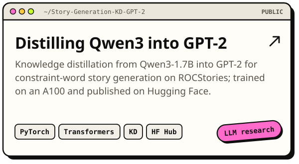</picture></a>
  <a href="https://github.com/Akshat-Gupta04/Eye-Disease-Detection-using-DeepLearning-and-GenerativeAi"><picture><source media="(prefers-color-scheme: dark)" srcset="assets/card-eye-disease-dark.svg"><source media="(prefers-color-scheme: light)" srcset="assets/card-eye-disease-light.svg">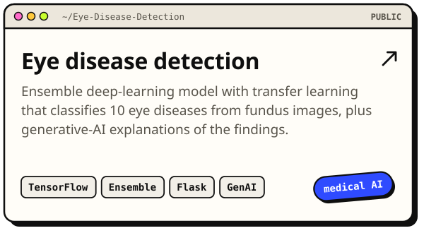</picture></a>

<a href="https://github.com/Akshat-Gupta04?tab=repositories">More on my repositories tab</a>

 

<picture><source media="(prefers-color-scheme: dark)" srcset="assets/div-03-dark.svg"><source media="(prefers-color-scheme: light)" srcset="assets/div-03-light.svg"></picture>

  <picture><source media="(prefers-color-scheme: dark)" srcset="assets/experience-dark.svg"><source media="(prefers-color-scheme: light)" srcset="assets/experience-light.svg">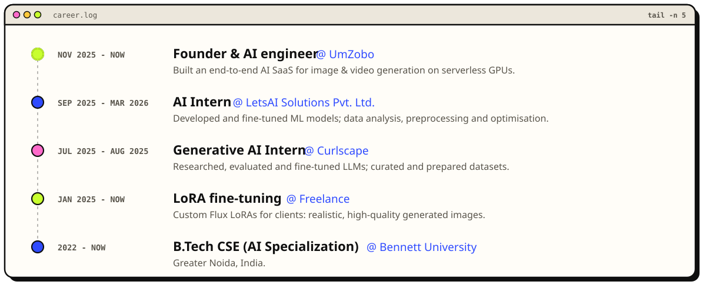</picture>

 

<picture><source media="(prefers-color-scheme: dark)" srcset="assets/div-04-dark.svg"><source media="(prefers-color-scheme: light)" srcset="assets/div-04-light.svg">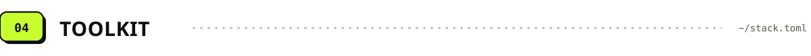</picture>

  <picture><source media="(prefers-color-scheme: dark)" srcset="assets/stack-dark.svg"><source media="(prefers-color-scheme: light)" srcset="assets/stack-light.svg">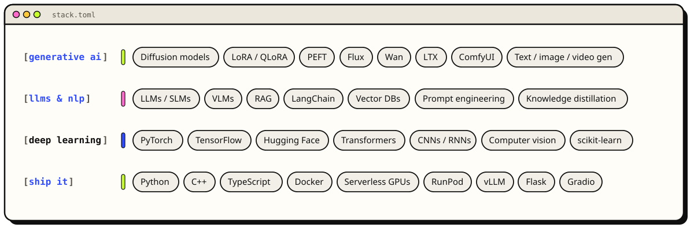</picture>

 

<picture><source media="(prefers-color-scheme: dark)" srcset="assets/div-05-dark.svg"><source media="(prefers-color-scheme: light)" srcset="assets/div-05-light.svg">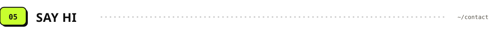</picture>

  <a href="https://akshat-gupta.tech"><picture><source media="(prefers-color-scheme: dark)" srcset="assets/btn-portfolio-dark.svg"></picture></a>
  <a href="https://umzobo.studio"><picture><source media="(prefers-color-scheme: dark)" srcset="assets/btn-umzobo-dark.svg"></picture></a>
  <a href="https://www.linkedin.com/in/akshat-gupta-077a7b256/"><picture><source media="(prefers-color-scheme: dark)" srcset="assets/btn-linkedin-dark.svg"></picture></a>
  <a href="mailto:akshat9306@gmail.com"><picture><source media="(prefers-color-scheme: dark)" srcset="assets/btn-email-dark.svg"></picture></a>

Designed to match <a href="https://akshat-gupta.tech">akshat-gupta.tech</a>.

